# Microtonal plugins for MuseScore 3.4+: Retune & transpose in almost any EDO

> ⚠️ **Note**: this is a maintained fork of the original
> [euwbah/musescore-microtonal-edo-plugin](https://github.com/euwbah/musescore-microtonal-edo-plugin).
> The original upstream project is deprecated in favour of
> [musescore-xen-tuner](https://github.com/euwbah/musescore-xen-tuner); this fork keeps the
> plugin working, adds **4-arrow accidental** support (sharp-9 / sharp-10 EDOs), a **flatter ~3/1
> generator** that fits meantone tunings, and a **`~3/1` score annotation** to change that generator
> on the fly.

Three plugins that together give MuseScore 3 a complete microtonal workflow:

| Plugin | What it does |
| --- | --- |
| **tune n-edo** | Retunes the selected notes, or the whole score if nothing is selected, to the chosen EDO temperament. |
| **pitch up** | Transposes selected notes up by 1 EDO step, automatically choosing the correct accidental spelling. |
| **pitch down** | Transposes selected notes down by 1 EDO step, automatically choosing the correct accidental spelling. |

---

## Tuning model

Every pitch in the score is represented in two layers:

1. a **chain of fifths** (the nominals `F C G D A E B`), and
2. an **EDO offset** (how many steps away from the nominal), written with up/down arrows.

The plugin maps a tuning lattice onto any EDO. The lattice is generated by two ratios, defined
once in the header of every plugin file (`generatorRatios`):

| Generator | Default ratio | Meaning |
| --- | --- | --- |
| 2/1 | `2` | the octave |
| ~3/1 | `2.9809640979213197` | a slightly **flattened** 3/1-based generator (a flatter twelfth, meaning the ~3/2, the fifth is also flatter) so the chain of fifths fits **meantone tunings** better |

From these ratios and the active EDO, the plugin computes the **fifth step**, the **sharpness**
(apotome size), and the whole-tone / semitone sizes, which drive all transposition and retuning.

- The default EDO is `7` (`defaultEdo`, defined once in each plugin header). Change it there if you
  want a different default.
- The default generator ratio is `2.9809640979213197` (the latter item of `generatorRatios`, in each
  plugin header). It can be overridden per staff / per measure with a `~3` annotation (see below).

---

## Installation

1. Download / copy this project into [MuseScore's plugins directory](https://musescore.org/en/handbook/3/plugins#windows).
2. Enable the plugins in *Plugins → Plugin Manager*:
   - `tune n-edo`
   - `pitch up`
   - `pitch down`
3. (Recommended) Assign keyboard shortcuts in *Edit → Preferences → Shortcuts*:
   - `tune n-edo` → `Alt-R`
   - `pitch up` → `Up arrow`
   - `pitch down` → `Down arrow`
   - Clear MuseScore's built-in *Pitch up / Pitch down* shortcuts first, otherwise the arrow keys
     will fight with the plugins.

After editing any `.qml` file, **restart MuseScore** (or close and reopen the score) for the
changes to take effect.

---

## Score annotations

All tuning information is driven by **Staff/System Text annotations**, so different staves (or
different bars) can use different tunings. Place each annotation in its own text element.

| Annotation | Example | Effect |
| --- | --- | --- |
| **EDO** | `42edo` | Sets the EDO for all staves (System Text) or one staff (Staff Text). |
| **Tuning center** | `D3: 144.45` | Sets the reference pitch: a note name + octave, then `:` then a frequency in Hz. `Hz` is optional. Default: `A4: 440`-equivalent (C4 reference). |
| **Generator ratio** | `~3: 2.997` | Overrides the ~3/1 generator ratio (the second element of `generatorRatios`). |
| **Key signature** | `.#...#...` | Annotates the custom key signature (see below). |
| **Transposition** | `t: Bb` | Declares a transposing instrument (fifth-based, e.g. `t: Bb`, `t: Eb`). |
| **Config** | `config: {showallaccidentals: true}` | Turns on courtesy accidentals for all notes. |

The text is case-insensitive. Only one modifier per text element.

### EDO annotation

Type the number followed by `edo`, e.g. `42edo`, `12edo`, `53edo`. Affects all staves if entered
as System Text (`Ctrl-Shift-T`), or only the current staff as Staff Text (`Ctrl-T`). If no EDO is
specified for a part, it defaults to `7`.

### Tuning-center annotation

Type `{note}: {frequency}`, e.g. `D3: 144.45` or `C4: 261.6255653005986Hz`. Affects the whole score
(System Text) or one staff (Staff Text).

### Generator ratio annotation (`~3` / `~3/1`)

Type `~3: <value>` or `~3/1: <value>`, where `<value>` is any **JavaScript expression** that
evaluates to a positive number. Spaces around the `:` are ignored. Examples:

- `~3: 2.997`
- `~3/1: 3.04`
- `~3/1   :  Math.pow(2,(26+15)/26)`
- `~3 :30/7*Math.LN2`

This replaces the ~3/1 element of the generator lattice, so the whole tuning system (fifth step,
sharpness, nominal pitches) is re-derived for the active EDO. It behaves exactly like the EDO and
tuning-center annotations: per-staff, and changeable mid-score.

### Key-signature annotation

For each key signature, create a System/Staff Text at the start of the same bar and type
`.c.d.e.f.g.a.b`, where each entry is the [accidental code](#accidental-code) applied to that
nominal (blank = natural). Example, D major: `.#...#...` (C♯ and F♯).

Due to plugin API limitations, **all** key signatures — even standard ones — should be accompanied
by this annotation.

### Transposing instruments

For a transposing instrument, add `t: Bb` (or `t: Eb`, etc.) at the start of the part. Fifth-based
transpositions (`x`, `#`, `b`, `bb`) are supported. The annotation is ignored in Concert Pitch mode.

---

## Notation system

The plugin follows the **ups and downs** notation described in
[Kite Giedraitis' notation guide](http://tallkite.com/misc_files/notation%20guide%20for%20edos%205-72.pdf).

### Nominals (chain of fifths)

The nominals `F C G D A E B` are tuned along a chain of **best fifths** — the closest
approximation of the (flattened) ~3/1 generator that the EDO offers. The sharpness (apotome size)
of an EDO is the number of EDO steps a sharp raises the pitch by:

- In 12-edo a sharp is **+1** step (sharp-1).
- In 7-edo a sharp is **0** steps (perfect / sharp-0).
- In some EDOs a sharp *lowers* the pitch (flat-n EDOs).

### Regular accidentals

`bbb`, `bb`, `b`, `#`, `x`, `#x` are based on the circle of fifths and move the pitch by the
appropriate multiple of the sharpness. Triple accidentals (`bbb`, `#x`) are **never generated** by
`pitch up`/`pitch down`, but are **recognised** and transposed to their correct enharmonic
equivalent.

### Up/down arrows

An up arrow always raises the pitch by exactly 1 EDO step; a down arrow always lowers it by
exactly 1 step, regardless of whether the sharp/flat symbol raises or lowers the pitch. E.g. in a
sharp-0 EDO, `C → C^ → C^2 → C^3 → C^4 → Dv → D` steps one edostep at a time.

A maximum of 3 arrows per accidental is natively supported by MuseScore.

### Half-integer accidentals

Stein-Zimmermann accidentals (`d`, `+`, `db`, `#+`) offset the pitch by half or
one-and-a-half times the sharpness, and are only usable when the sharpness is even.

### 4-arrow accidentals (the "Addon")

MuseScore does not provide accidentals with 4 arrows, which are needed for **sharp-9** and
**sharp-10** EDOs. This fork repurposes 10 existing MuseScore accidentals as 4-arrow substitutes:

| Text | Internal name | Looks like |
| --- | --- | --- |
| `v4` | `LOWER_ONE_SEPTIMAL_COMMA` |  |
| `^4` | `RAISE_ONE_SEPTIMAL_COMMA` | 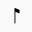 |
| `#v4` | `RAISE_ONE_TRIDECIMAL_QUARTERTONE` |  |
| `#^4` | `SHARP_SLASH2` |  |
| `bv4` | `THREE_TWELFTH_FLAT` | 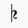 |
| `b^4` | `FOUR_TWELFTH_FLAT` | 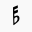 |
| `bbv4` | `NINE_TWELFTH_FLAT` | 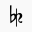 |
| `bb^4` | `TEN_TWELFTH_FLAT` | 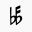 |
| `xv4` | `SAGITTAL_SHARP25SD` | 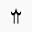 |
| `x^4` | `DOUBLE_SHARP_EQUAL_TEMPERED` | 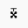 |

`pitch up`/`pitch down` will happily produce and continue through these 4-arrow accidentals (e.g.
`C → C^ → C^2 → C^3 → C^4 → Dv → D` in 42-edo), exactly like 1-, 2- and 3-arrow accidentals.

---

## Accidental code

All accidental codes used in key-signature annotations:

| Accidental | Text | | Accidental | Text |
| --- | --- | --- | --- | --- |
| triple flat | `bbb` | | 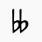 double flat | `bb` |
| 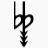 | `bbv3` | | 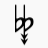 | `bbv2` |
| 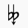 | `bbv` / `bbv1` | |  | `bbv4` |
| 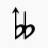 | `bb^` / `bb^1` | | 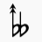 | `bb^2` |
| 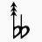 | `bb^3` | |  | `bb^4` |
|  sesqui flat | `db` / `bd` | | 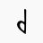 half flat | `d` |
| 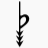 | `bv3` | | 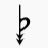 | `bv2` |
| 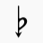 | `bv` / `bv1` | |  | `bv4` |
| 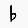 flat | `b` | | 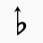 | `b^` / `b^1` |
| 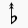 | `b^2` | | 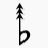 | `b^3` |
|  | `b^4` | | 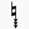 | `v3` |
| 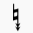 | `v2` | | 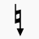 | `v` / `v1` |
|  | `v4` | | 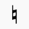 natural | *(blank)* |
| 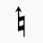 | `^` / `^1` | | 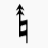 | `^2` |
|  | `^3` | |  | `^4` |
| 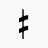 half sharp | `+` | | 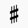 sesqui sharp | `#+` / `+#` |
| 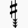 | `#v3` | | 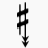 | `#v2` |
| 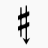 | `#v` / `#v1` | |  | `#v4` |
| 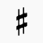 sharp | `#` | | 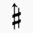 | `#^` / `#^1` |
| 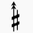 | `#^2` | | 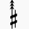 | `#^3` |
|  | `#^4` | | 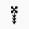 | `xv3` |
| 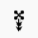 | `xv2` | | 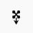 | `xv` / `xv1` |
|  | `xv4` | |  double sharp | `x` |
|  | `x^` / `x^1` | | 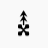 | `x^2` |
| 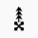 | `x^3` | |  | `x^4` |
| triple sharp | `#x` | | | |

> Note: there are no dedicated glyphs for `bbb` / `#x` in this reference; they are generated by
> `tune n-edo` and handled (but never emitted) by `pitch up` / `pitch down`.

---

## Supported EDOs and the notational limit

Whether an EDO can be **fully notated** depends on *two* numbers, not just sharpness:

1. **Sharpness** — the apotome size, the vertical coordinate below. It is computed with the
   default generator ratio `2.9809640979213197`.
2. **The largest leak** between adjacent nominals — the horizontal coordinate below. For each
   adjacent pair `(N, N+1)` (e.g. C–D, or B–next-period C), it is the number of EDO steps between
   the sharpest spelling of `N` and the flattest spelling of `N+1` — `x(N)` to `bb(N+1)` (or
   `bb(N)` to `x(N+1)` when the sharpness is negative). The largest value over all adjacent pairs
   is the horizontal coordinate.

An EDO is fully notatable **if and only if**:

- **|sharpness| ≤ 10** (thanks to the 4-arrow Addon), **and**
- **largest leak ≤ 9**.

If the sharpness is above 10 there are not enough arrows between adjacent accidentals; if the
largest leak is above 9, the arrow set has a gap ("leak") that cannot be bridged between two
adjacent nominals.

The complete pattern for EDOs **1–323** as a table (rows = sharpness, columns = largest leak).
EDOs marked `*` are **not fully notatable with the default ~3/1 ratio** (largest leak > 9, or
sharpness outside ±10):

| sharp | -12 | -11 | -10 | -9 | -8 | -7 | -6 | -5 | -4 | -3 | -2 | -1 | 0 | 1 | 2 | 3 | 4 | 5 | 6 | 7 | 8 | 9 | 10 | 11 | 12 | 13 | 14 | 15 | 16 | 17 | 18 | 19 | 20 | 21 | 22 |
| --- | --- | --- | --- | --- | --- | --- | --- | --- | --- | --- | --- | --- | --- | --- | --- | --- | --- | --- | --- | --- | --- | --- | --- | --- | --- | --- | --- | --- | --- | --- | --- | --- | --- | --- | --- |
| -3 | | | | 6 | 13 | | | | | | | | | | | | | | | | | | | | | | | | | | | | | | |
| -2 | | | | | | | 4 | 11 | 18 | 25 | 32 | 39 | 46 | | | | | | | | | | | | | | | | | | | | | | |
| -1 | | | | | | | | | | 2 | 9 | 16 | 23 | 30 | 37 | 44 | 51 | 58 | 65 | 72 | 79 | | | | | | | | | | | | | | |
| 0 | | | | | | | | | | | | | | 7 | 14 | 21 | 28 | 35 | 42 | 49 | 56 | 63 | 70* | 77* | 84* | 91* | 98* | 105* | 112* | | | | | | |
| 1 | | | | | | | | | | 5 | 12 | 19 | 26 | 33 | 40 | 47 | 54 | 61 | 68 | 75 | 82 | 89 | 96* | 103* | 110* | 117* | 124* | 131* | 138* | 145* | | | | | |
| 2 | | | | | | 3 | 10 | 17 | 24 | 31 | 38 | 45 | 52 | 59 | 66 | 73 | 80 | 87 | 94 | 101 | 108 | 115 | 122* | 129* | 136* | 143* | 150* | 157* | 164* | 171* | 178* | | | | |
| 3 | | 1 | 8 | 15 | 22 | 29 | 36 | 43 | 50 | 57 | 64 | 71 | 78 | 85 | 92 | 99 | 106 | 113 | 120 | 127 | 134 | 141 | 148* | 155* | 162* | 169* | 176* | 183* | 190* | 197* | 204* | 211* | | | |
| 4 | 20 | 27 | 34 | 41 | 48 | 55 | 62 | 69 | 76 | 83 | 90 | 97 | 104 | 111 | 118 | 125 | 132 | 139 | 146 | 153 | 160 | 167 | 174* | 181* | 188* | 195* | 202* | 209* | 216* | 223* | 230* | 237* | 244* | | |
| 5 | | 53 | 60 | 67 | 74 | 81 | 88 | 95 | 102 | 109 | 116 | 123 | 130 | 137 | 144 | 151 | 158 | 165 | 172 | 179 | 186 | 193 | 200* | 207* | 214* | 221* | 228* | 235* | 242* | 249* | 256* | 263* | 270* | 277* | |
| 6 | | | 86 | 93 | 100 | 107 | 114 | 121 | 128 | 135 | 142 | 149 | 156 | 163 | 170 | 177 | 184 | 191 | 198 | 205 | 212 | 219 | 226* | 233* | 240* | 247* | 254* | 261* | 268* | 275* | 282* | 289* | 296* | 303* | 310* |
| 7 | | | | 119 | 126 | 133 | 140 | 147 | 154 | 161 | 168 | 175 | 182 | 189 | 196 | 203 | 210 | 217 | 224 | 231 | 238 | 245 | 252* | 259* | 266* | 273* | 280* | 287* | 294* | 301* | 308* | 315* | 322* | | |
| 8 | | | | | 152 | 159 | 166 | 173 | 180 | 187 | 194 | 201 | 208 | 215 | 222 | 229 | 236 | 243 | 250 | 257 | 264 | 271 | 278* | 285* | 292* | 299* | 306* | 313* | 320* | | | | | | |
| 9 | | | | | | 185 | 192 | 199 | 206 | 213 | 220 | 227 | 234 | 241 | 248 | 255 | 262 | 269 | 276 | 283 | 290 | 297 | 304* | 311* | 318* | | | | | | | | | | |
| 10 | | | | | | | 218 | 225 | 232 | 239 | 246 | 253 | 260 | 267 | 274 | 281 | 288 | 295 | 302 | 309 | 316 | 323 | | | | | | | | | | | | | |
| 11 | | | | | | | | 251* | 258* | 265* | 272* | 279* | 286* | 293* | 300* | 307* | 314* | 321* | | | | | | | | | | | | | | | | | |
| 12 | | | | | | | | | 284* | 291* | 298* | 305* | 312* | 319* | | | | | | | | | | | | | | | | | | | | | | |
| 13 | | | | | | | | | | 317* | | | | | | | | | | | | | | | | | | | | | | | | | | |

`*` — not fully notatable with the default ~3/1 ratio (largest leak > 9, or sharpness outside ±10);
a custom `~3` annotation may help for the leak cases, but never for sharpness outside ±10.

**The largest fully-notatable EDO is 323** (sharp-10, largest leak 9). This maximum **cannot be
improved by changing the ~3/1 generator** — it is fixed at 323 regardless of the ratio (changing
~3/1 can only keep it at 323 or lower).

However, some EDOs *below* 323 that are **not** fully notatable at the default ratio may become
fully notatable if the ~3/1 generator is changed (via a `~3` annotation), since that shifts both
the sharpness and the leak pattern.

---

## Known issues

- Cross-staff notation is not handled: accidentals in the staff a note is transferred to do not
  affect notes originally belonging to that staff.
- Grace notes that attach *after* their main note are processed as if they were before, which can
  cause issues when transposing. Prefer grace notes that attach before.
- Chords with two notes sharing the same staff line (e.g. an F and an F♯) are handled best when
  both notes carry explicit accidentals.
- Triple-flat / triple-sharp notes are never *generated* by `pitch up`/`pitch down`; they are
  recognised and respelled to their correct enharmonic (e.g. in 26-edo, `bbbC` is `B`, so
  `pitch down` turns it into `bB`).

---

## Developer notes

- `note.accidentalType` returns the *stringified* enum name (e.g. `"NATURAL_ARROW_UP"`); use
  `0 + note.accidentalType` to get the integer enum value. Do **not** compare it with `===`/`!==`
  to `Accidental.*`.
- When changing a note's pitch programmatically, the correct order is: set the **line**, set the
  **accidental**, then set the **tuning**.
- The tuning lattice constants (`generatorRatios`) and default EDO (`defaultEdo`) live once in each
  plugin header; `getTuningConstants(edo, ratio)` derives `val`, `fifthStep`, `sharpValue`,
  `wholeToneSteps` and `semitoneSteps` from them.
- `parseGeneratorRatio(text)` implements the `~3` / `~3/1` annotation parser.

---

## Credits

- Tuning method generalized from [FloraCanou's MuseScore n-TET plugins](https://github.com/FloraCanou/musescore-n-tet-plugins).
- Original plugin and ups/downs algorithm by [euwbah](https://github.com/euwbah).
- 4-arrow Addon, flattened ~3/1 generator, and `~3` annotation added in this fork.
